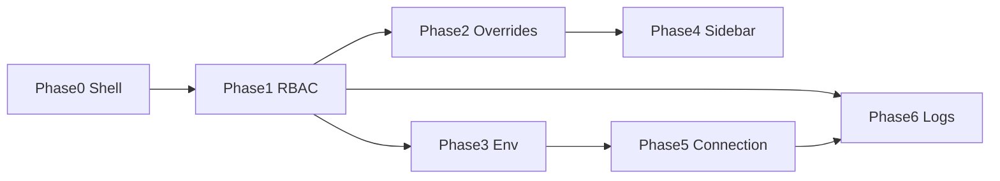

# CCo Execution Plan — Phased Build Order

## Phase 0 — Shell + isolated Vercel theme ✅

- CCo overlay from `Ctrl+Shift+Alt+M` (super_admin)
- `data-theme="cco-vercel"` scoped CSS; Geist on CCo only
- Layout: left nav, top bar, 9 feature placeholders
- `/control` route kept for proto-control migration

**Verify:** Login as super_admin → shortcut → overlay; main dashboard unchanged green theme.

## Phase 1 — RBAC (highest reuse) ✅

1. `cco-rbac.service.ts` wrapping `getAdmins`, `updateAdminRolePermissions`, `createAdmin`
2. `cco-rbac-panel.tsx` in overlay **RBAC** nav; `/control` reuses same panel (Vercel-scoped)
3. testing-agent sign-off — manual smoke recommended

## Phase 2 — Shortcut settings + dashboard override ✅

1. `cco-shortcut.service` + `cco-shortcut-config` + Shortcut panel
2. `cco-dashboard-override.service` + Dashboard panel (prefs moved from RBAC)
3. Server sync when API exists

## Phase 3 — Environment CRUD ✅

1. `cco-env.service` wraps system config + build-time env list
2. Env panel — runtime safe fields + read-only `NEXT_PUBLIC_*`

## Phase 4 — Sidebar CRUD ✅

1. `admin-nav-config.ts` shared nav
2. `cco-sidebar.service` + Sidebar panel (localStorage until API)

## Phase 5 — IP / secrets + connection control ✅

1. `cco-secrets.service` + `cco-connection.service`
2. Panels wired; full IP allowlist blocked on backend

## Phase 6 — Logs + activity log ✅

1. `cco-activity.service` + `recordCcoActivity` on mutations
2. Logs panel — backend gap messaging when no API

## Dependency diagram

## Per-slice report template

- ✅ Built
- 🔗 Reused / abstracted (paths)
- 📋 AgenticWorkflows adherence
- ⚠️ Risks / blockers
